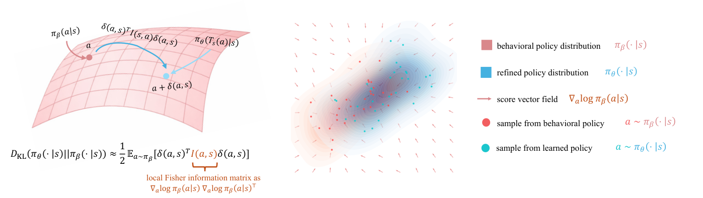
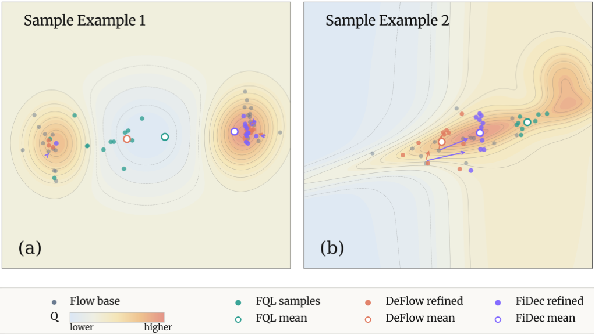
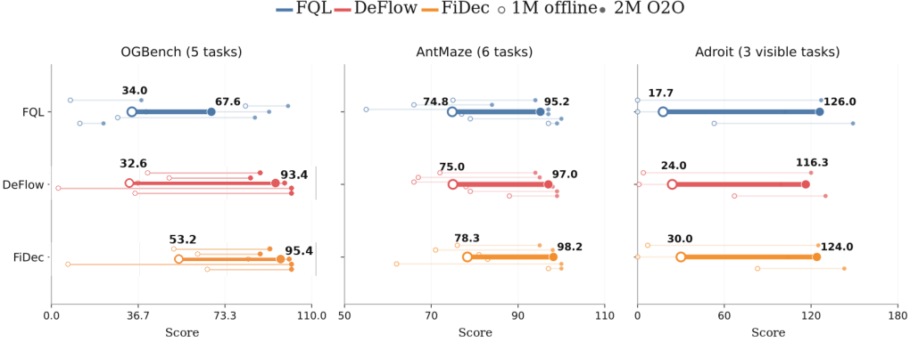

<div align="center">

# Fisher Decorator
### Refining Flow Policy via a Local Transport Map

**Accepted at NeurIPS 2026 · Poster**

Xiaoyuan Cheng\* · [Haoyu Wang](https://arc0127.github.io/)\* · Wenxuan Yuan · Ziyan Wang · Zonghao Chen · Li Zeng · Zhuo Sun†

<sub>\* Equal contribution. † Corresponding author.</sub>

[](https://arxiv.org/abs/2604.17919)
[](https://arxiv.org/abs/2604.17919)
[](https://arc0127.github.io/Fisher-Decorator/)

[Paper](https://arxiv.org/abs/2604.17919) · [Project page](https://arc0127.github.io/Fisher-Decorator/) · [Quick start](#quick-start) · [Results](#results) · [Citation](#citation)

</div>

<p align="center"></p>

**Fisher Decorator (FiDec)** is a flow-based offline reinforcement learning method that refines a behavioral policy with a residual local transport map. Fisher information gives the refinement an anisotropic metric, weighting action displacements by the local geometry of the behavioral distribution.

This repository contains the official **JAX / Flax** implementation. The paper evaluates **73 offline tasks** and **14 offline-to-online tasks**, including navigation, locomotion, manipulation and visual control.

## News

- **September 2026:** Fisher Decorator was accepted at **NeurIPS 2026** as a **Poster**.
- **April 2026:** [Paper](https://arxiv.org/abs/2604.17919) and implementation released.

## Method at a glance

1. **Learn the behavior.** Train a flow policy on the offline dataset to generate a base action $a=\mu_\beta(s,z)$.
2. **Estimate the geometry.** Use the flow velocity to estimate the score and construct a local Fisher metric $I(s,a)$.
3. **Refine locally.** Learn a residual transport map $T_s(a)=a+\delta(s,a)$, improving action value under a Fisher-weighted displacement constraint.

The paper relates this constraint to a local quadratic approximation of KL divergence. The [method section](https://arxiv.org/html/2604.17919v2#S3) gives the derivations, assumptions and approximation bounds.

<p align="center"></p>
<p align="center"><sub>Illustrative policy-refinement examples from Figure 3. See the paper for the complete comparison.</sub></p>

## Quick start

### 1. Get the code and prepare an environment

```bash
git clone https://github.com/ARC0127/Fisher-Decorator.git
cd Fisher-Decorator
python -m venv .venv
source .venv/bin/activate
python -m pip install --upgrade pip
python -m pip install jax flax optax distrax ml-collections absl-py \
  numpy tqdm wandb pillow gymnasium ogbench
```

These dependencies are imported by the OGBench training path. The repository does not currently pin a reproduced environment. The commands above install the default JAX package; for GPU training, follow the official [JAX installation instructions](https://docs.jax.dev/en/latest/installation.html) for your accelerator. The examples use a POSIX shell.

### 2. Train FiDec on OGBench

```bash
WANDB_MODE=offline python main.py \
  --env_name=cube-double-play-singletask-v0 \
  --agent=agents/fidec.py \
  --offline_steps=1000000 \
  --seed=0
```

**Pass `--agent=agents/fidec.py` explicitly:** `main.py` defaults to the DeFlow agent. `WANDB_MODE=offline` stores experiment tracking locally without requiring a Weights & Biases login.

OGBench data is loaded through `ogbench.make_env_and_datasets`. Set `OGBENCH_DATA_DIR=/path/to/data` to choose the dataset directory.

The five-task comparison script supplies task-specific settings and compares DeFlow with FiDec:

```bash
bash scripts/run_ogbench_default_task5_baseline_fidec.sh
```

It uses `fisher_t=0.90`, `fisher_t_width=0.05`, eight Fisher samples and damping of `1e-3`. See [the script](scripts/run_ogbench_default_task5_baseline_fidec.sh) and [environment-specific flags](scripts/ogbench_env_flags.sh) before reproducing a particular experiment. A single training command is an example, rather than the full 73-task evaluation protocol.

### D4RL

D4RL requires an additional legacy Gym / MuJoCo environment and a compatible Gymnasium / Shimmy bridge. Follow the [D4RL setup instructions](https://github.com/Farama-Foundation/D4RL); this repository's wrapper uses `GymV21Environment-v0`.

With that environment installed:

```bash
WANDB_MODE=offline python main.py \
  --env_name=antmaze-medium-play-v2 \
  --agent=agents/fidec.py \
  --offline_steps=1000000 \
  --seed=0
```

The environment dispatcher supports **OGBench single-task environments, D4RL AntMaze and D4RL Adroit**. See [`envs/env_utils.py`](envs/env_utils.py) for the supported branches.

### Offline-to-online fine-tuning

For state-based tasks, continue training by adding `--online_steps`:

```bash
WANDB_MODE=offline python main.py \
  --env_name=cube-double-play-singletask-v0 \
  --agent=agents/fidec.py \
  --offline_steps=1000000 \
  --online_steps=1000000 \
  --seed=0
```

To continue from an existing run, use `--restore_path` and `--restore_epoch` with the matching agent configuration. [`scripts/run_ogbench_default_task5_online_from_offline.sh`](scripts/run_ogbench_default_task5_online_from_offline.sh) provides a batch example. **Visual online fine-tuning is currently unsupported** by `main.py`.

### Useful options

| Option | Purpose |
| :-- | :-- |
| `--agent=agents/fidec.py` | Select the FiDec agent. |
| `--seed` | Set the random seed. |
| `--save_dir` | Choose the output root. |
| `--eval_interval`, `--eval_episodes` | Configure evaluation frequency and number of episodes. |
| `--save_interval` | Configure model saving frequency. |
| `--agent.fisher_t`, `--agent.fisher_t_width` | Set the nominal Fisher estimation time and its sampling width. |
| `--agent.num_fisher_samples` | Set the number of samples for Fisher estimation. |
| `--agent.target_divergence` | Set the refinement constraint budget. |
| `--agent.fisher_damping` | Set Fisher damping before trace normalization. |

Runs write configuration to `flags.json`, metrics to `train.csv` / `eval.csv`, and saved model parameters to `params_<step>.pkl` under the run directory. Agent defaults are in [`agents/fidec.py`](agents/fidec.py).

## Results

Selected **flow-policy comparisons** from [Table 2](https://arxiv.org/html/2604.17919v2#S4.T2), reported over eight random seeds. This summarizes the paper's results, rather than a new evaluation. The full table includes 12 methods and all 73 tasks.

| Benchmark category | Tasks | FQL | DeFlow | FiDec |
| :-- | --: | --: | --: | --: |
| OGBench AntMaze · large | 5 | 79 ± 3 | 81 ± 11 | **87 ± 1** |
| OGBench HumanoidMaze · medium | 5 | 58 ± 5 | 57 ± 29 | **72 ± 2** |
| OGBench Cube · double | 5 | 29 ± 1 | 38 ± 22 | **43 ± 4** |
| OGBench Puzzle · 3 × 3 | 5 | 30 ± 1 | 24 ± 38 | **43 ± 1** |
| D4RL AntMaze | 6 | 84 ± 3 | 81 ± 7 | **87 ± 1** |
| D4RL Adroit | 12 | **52 ± 1** | 34 ± 41 | 46 ± 2 |
| Visual manipulation | 5 | **65 ± 2** | 59 ± 38 | 64 ± 1 |

Bold marks the highest reported mean among the three methods shown; it does not indicate statistical significance. The [project page](https://arc0127.github.io/Fisher-Decorator/#results) includes every Table 2 task category for these three flow methods.

<p align="center"></p>
<p align="center"><sub>Offline-to-online fine-tuning on 14 tasks, starting after 1M offline gradient steps. Figure 4 in the paper.</sub></p>

## Repository guide

```text
agents/fidec.py       FiDec agent and default configuration
agents/deflow.py      DeFlow baseline
agents/deflowvf.py    DeFlow variant
envs/                OGBench and D4RL environment / dataset loading
utils/               Networks, data, evaluation and logging
scripts/             Batch training and result summaries
main.py              Offline training and online fine-tuning entry point
docs/                Static paper project website
```

The project website is buildless HTML / CSS / JavaScript. Preview it with `python -m http.server 8000 --directory docs`. For GitHub Pages, publish the `docs/` directory from `main`; site assets use relative paths.

## Citation

If you use this work, please cite the paper. This entry identifies the arXiv preprint; the work was accepted at NeurIPS 2026 as a Poster.

```bibtex
@misc{cheng2026fisherdecorator,
  title={Fisher Decorator: Refining Flow Policy via a Local Transport Map},
  author={Xiaoyuan Cheng and Haoyu Wang and Wenxuan Yuan and Ziyan Wang
          and Zonghao Chen and Li Zeng and Zhuo Sun},
  year={2026},
  eprint={2604.17919},
  archivePrefix={arXiv},
  primaryClass={cs.LG},
  url={https://arxiv.org/abs/2604.17919}
}
```

[Download BibTeX](docs/assets/citation.bib)

## Acknowledgements

The research presented in this paper is led by Xiaoyuan Cheng and Haoyu Wang. The core codebase is primarily developed by Xiaoyuan Cheng and Haoyu Wang.

This repository partially builds upon implementations from [DeFlow: Decoupling Manifold Modeling and Value Maximization for Offline Policy Extraction](https://arxiv.org/abs/2601.10471).

This work was supported by funding from Prof. Zhuo Sun.

For research questions, contact [Xiaoyuan Cheng](mailto:ucesxc4@ucl.ac.uk) or [Haoyu Wang](mailto:create_arc@sjtu.edu.cn). For code issues, please [open an issue](https://github.com/ARC0127/Fisher-Decorator/issues).
